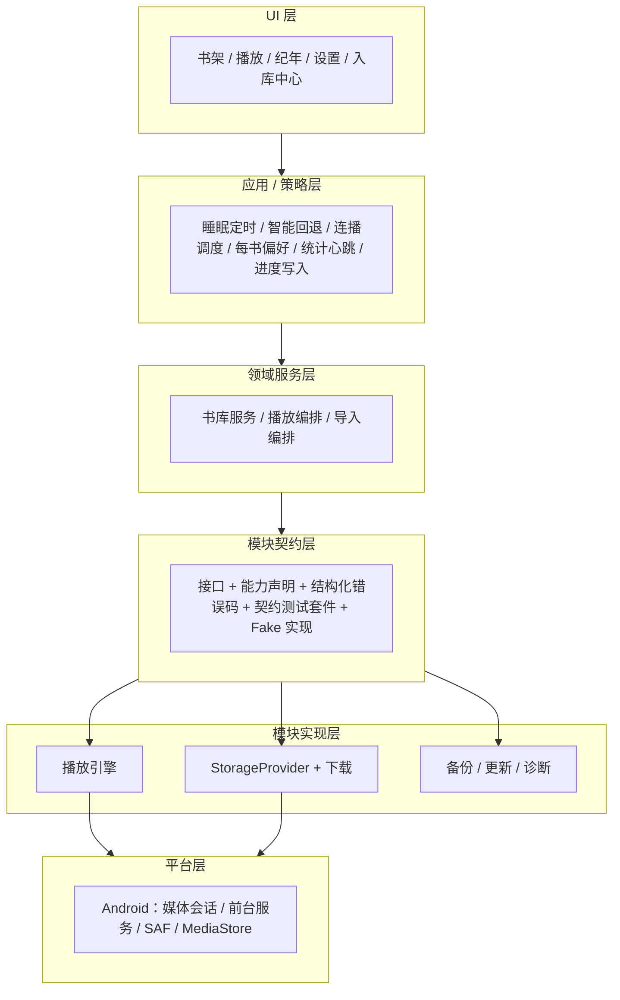
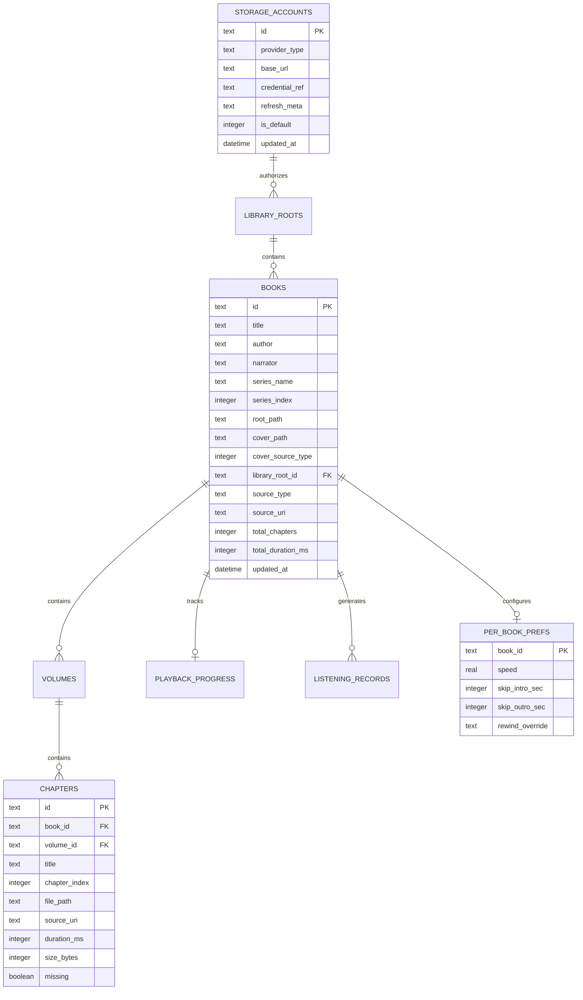

# TomeTone · 听卷 | 架构需求文档

> **文档版本**：v3.1.0
> **取代**：v2.0.0《完整产品需求规格说明书》（已按流程移除，git 历史可查）
> **文档状态**：基线草案 · 对应测试版本（`0.x` beta 通道）
> **编写时间**：2026-10-17
> **产品形态**：手机端为主（Android-first），架构保留桌面端扩展路径；本地优先、离线可用

---

## 0. 文档说明

### 0.1 目的与范围

本文档是 TomeTone（听卷）的**统一架构与需求基线**，合并并取代原 PRD v2.0.0。

- **Part A 产品需求**：定位、功能、界面交互、验收标准
- **Part B 架构设计**：分层、模块契约、数据模型、质量属性、安全
- **Part C 路线与治理**：路线图、测试策略、决策登记、附录

配套文档：仓库根目录 `CHANGELOG.md` 为发布记录的唯一来源。

### 0.2 版本谱系与修订记录

| 文档版本 | 日期 | 说明 |
| :--- | :--- | :--- |
| v2.0.0 | 2026-10-17 | Clean Architecture & Local-First 首版 PRD（已被取代） |
| v3.0.0 | 2026-10-17 | 合并两轮评审与外部调研：模块化架构、网盘入库通道重构、凭据与备份、版本发布与检查更新；旧文档移除 |
| v3.1.0 | 2026-10-17 | 复审补充：书库检索与筛选；Android 平台适配口径；章节身份与重链规则；恢复向导；自包含修复（微回退阶梯表 / 媒体格式清单 / 心跳采计口径） |

### 0.3 术语表

| 术语 | 定义 |
| :--- | :--- |
| 播放引擎（Playback Engine） | 负责音频解码与输出的**可替换模块**。不含任何业务策略。 |
| StorageProvider | 统一存储访问抽象。本地目录、SAF、WebDAV、SMB、直连网盘等均实现同一契约。 |
| 入库通道（Import Pipeline） | 把外部资源（文件夹 / 网盘 / 分享）转换为书库条目的全流程。**网盘模块的定位是入库通道，不是网盘文件管理器。** |
| 听书源（Book Source） | 兼容 Legado `bookSourceType:1` 的在线音频源规则。 |
| 源解析器（Source Resolver） | 解释听书源规则、提取在线直链的模块。 |
| 单文件多章 | m4b / cue 等"一个文件内含多章"的资源形态（分档支持）。 |
| 混合书架 | 本地与远程条目在同一书架展示、统一播放与进度管理。 |
| 字节管道（Byte Pipe） | 本地回环代理，为播放器统一提供认证、Range、缓存与预取（M2+ 引入）。 |
| 契约测试（Conformance Test） | 每个模块实现必须通过的统一测试套件（含 Fake 实现）。 |

### 0.4 非目标（Non-Goals）

- 不做电子书 / 漫画阅读
- 不做播客订阅
- 不做中心化账号与自建云服务；零注册、零登录
- **不做网盘私有接口逆向工程**（见 2.5）
- 不破解任何 DRM
- v1 不承诺 iOS；桌面端仅保留架构路径与引擎候选（M4+ 探路）
- 不做社交、评论、内容推荐

---

## Part A 产品需求

### 1. 产品定位

#### 1.1 使命

TomeTone（听卷）是面向**长篇有声书重度用户**的本地优先藏馆与播放器：高保真、沉浸式、离线完整可用；通过"入库通道"把本地与网盘中的有声资源纳入统一书库；模块化架构保证播放引擎与存储后端可替换、可演进。

#### 1.2 目标画像

1. **长篇连载 / 大部头听友**：单部作品数卷、上千集，对排序准确性、跨卷连播有极致要求；常从网盘收书。
2. **通勤与睡前伴听用户**：要求防打断微回退、睡眠定时、防外放保护。
3. **离线收藏家**：TB 级本地资源 + 网盘存货，追求纯本地掌控感，排斥绑卡与下架。

#### 1.3 核心设计原则

- **本地优先，离线完整**：无网络时全部核心功能可用。
- **拇指工学**：高频交互下沉屏幕下半区，单手盲操。
- **声学心理**：阶梯微回退、睡眠守夜、跨卷无缝连播。
- **模块化与策略 / 机制分离**：播放引擎、存储后端、源解析器可替换；**业务策略（睡眠、回退、连播、统计）永远在核心层**。
- **数据安全铁律**：绝不物理删除用户文件；绝不静默删除任何用户数据（凭据失效只"失效"不清库）。

### 2. 功能需求

> 每模块标注处置：**保留 / 修订 / 新增 / 降级**。

#### 2.1 书卷藏馆（The Vault）

**多书库根（新增）**

- 支持多个书库根目录：内部存储 / SD 卡 / SAF 授权目录 /（未来）网盘目录；每根独立扫描、可单独刷新。

**扫描与建库（修订）**

- 拓扑推导（保留）：单卷平铺 / 多卷嵌套 → 书 → 卷 → 章。
- 媒体格式兼容（保留）：`mp3 / m4a / m4b / aac / flac / wav / ogg / opus`；非音频文件忽略。
- **两阶段扫描（修订口径）**：第一阶段建立书 / 卷 / 章结构与排序（万级章节首屏目标 ≤3s，参考机型见附录 D）；第二阶段异步回填时长、内嵌封面与标签，不阻塞首屏。
- 增量扫描：仅处理新增 / 变更 / 消失；消失文件标记"缺失"而非删除记录。

**自然排序（保留 + 语料化）**

- 阿拉伯数字与中文序数（一 / 二 / 十 / 百 / 千）统一映射比对。
- 排序语料库纳入验收：`第1章 / 第一章 / 楔子 / 序 / 番外 / 卷三` 等混合命名的既定顺序。

**书库检索与筛选（新增）**

- 检索：书名 / 作者 / 演播者 / 系列名（本地索引，离线可用）。
- 筛选：书库根 / 系列 / 收听状态（未听 / 在听 / 已完）/ 缺失文件。
- 排序：最近收听 / 最近加入 / 标题 / 系列序号。
- 规模口径：万书 / 十万章数据集下检索与筛选 ≤300ms（数据集与机型见附录 D）。

**封面五级继承（修订）**

1. 卷目录图片（`cover.jpg` / `folder.png` 等）
2. 书根目录图片
3. 首卷封面反哺
4. **首章内嵌封面（新增级：ID3v2 APIC / MP4 covr）**
5. 几何字标兜底（国风主题色）

**元数据管理（新增）**

- 书名 / 作者 / 演播者 / 系列名 + 系列序号 / 简介的编辑。
- 默认存为库内覆盖层（overlay），不被重扫描覆盖。
- 提供"写入音频文件标签"可选操作：显式触发、原子写、失败不损坏原文件。

**章节导航与丢文件重链（新增）**

- 章节列表直达 / 跳转；缺失文件章节保留占位并高亮。
- 同路径替换自动恢复；手动指认重链；书级批量重链。

**单文件多章（新增，分档）**

- m4b：M1 支持整文件播放；章节表解析（纯 Dart MP4 box 方案，先做 spike 验证）通过后提供章节识别，M2 完整化。
- cue：仅承诺 FLAC / WAV 分轨（GB18030 / UTF-8 编码探测）；**明确不支持 APE / WavPack**。

**文件纪律（强制）**

- 扫描与整理**永不移动、重命名或删除**用户文件；一切"整理"以书库元数据实现。

#### 2.2 声学大台（The Stage）

- **跨卷连播（保留）**：章内顺序 → 卷边界 → 全书完毕态归零。
- **上一曲判定（保留）**：>3s 重播本章；≤3s 回上一章（可跨卷）；全书首章回 0 秒。
- **智能微回退（保留 + 自包含重述）+ 一键撤销（新增）**：`TargetPos = max(0, SavedPos - Rewind(ΔT))`；恢复后 10 秒内可一键撤销回退。回退阶梯：

  | 中断间隔 ΔT（暂停 → 恢复） | 回退 Rewind | 典型场景 |
  | :--- | :--- | :--- |
  | < 30 秒 | 0 秒（即点即播，不回退） | 短暂查看消息 |
  | 30 秒 – 5 分钟 | 3 秒 | 接电话 / 收发消息 |
  | 5 – 30 分钟 | 8 秒 | 短暂用餐 / 换乘 |
  | ≥ 30 分钟或跨进程重启 | 15 秒 | 深度中断 / 隔夜唤醒 |

- **睡眠守夜（修订，三模式）**：
  1. 相对倒计时（15 / 30 / 45 / 60 分钟或自定义，渐弱后暂停）
  2. 播完当前章即停
  3. **回到 N 分钟前（新增）**：针对入睡造成的"无效收听段"，恢复时一键回退 N 分钟（默认 10，可配置）；支持撤销。
- **双层时间轴（保留）**：全书宏观 + 章节微观。
- **五键下沉控制台（保留）**：上一曲 / 快退 15s / 播放暂停 / 快进 30s / 下一曲；0.5–3.0× 无级变速。
- **每书播放偏好（新增）**：倍速记忆、片头 / 片尾跳过秒数、回退阶梯覆盖。
- **进度写入可靠性（新增）**：关键事件立即写（暂停 / 切章 / 退后台），播放中每 10s 节流；崩溃最多丢 ≤10s 进度；SQLite WAL。
- **后台与系统集成（保留 + 扩展）**：前台媒体服务（`FOREGROUND_SERVICE_MEDIA_PLAYBACK`）、MediaNotification、锁屏控制、耳机 / 蓝牙线控（AVRCP）、拔耳机防外放；**音频焦点（新增）**：来电 / 导航自动压低-暂停-恢复；Android Auto 列为 M4+ 候选。
- **Android 平台适配口径（新增）**：targetSdk 34+ 在 Manifest 声明前台服务类型 `mediaPlayback`（配合 `FOREGROUND_SERVICE_MEDIA_PLAYBACK` 权限）；媒体会话通知豁免 Android 13+ `POST_NOTIFICATIONS`（下载等非豁免场景按需申请）；电池优化（Doze / OEM 省电）收敛为设置页文案说明（含跳转系统设置入口），保障长播不中断。

#### 2.3 聆听纪年（Chronicle）

- 30 秒心跳切片（保留）：仅真实播放态采计（暂停 / 缓冲 / 停止不计，排除挂机虚增）；写入事务化、崩溃安全（修订）。
- 今日 / 累计统计、365 天热力图、足迹时间流（保留）。

#### 2.4 听书源工坊（Source Forge）——**降级为实验性**

- 兼容 Legado 音频源、多语法提取、聚合检索：设计保留。
- **交付策略（修订）**：实验性功能，默认隐藏 / 关闭；启用需显式同意"网络与隐私说明"；目标 M4+ 回归（1.x 实验通道）。
- 隐私：仅用户主动启用后发起网络请求；与"离线完整可用"的默认形态严格隔离。

#### 2.5 入库通道与网盘（Import & Netdisk）——**新增模块**

**定位**：把外部资源变成书库条目（浏览 → 下载 → 入库）。**不是**网盘文件管理器：不做重命名 / 移动 / 转存 / 生成分享等网盘侧操作。

**渠道矩阵**

| 渠道 | 里程碑 | 说明 |
| :--- | :--- | :--- |
| 本地文件夹 / SAF 多根 | M1 | 书库扫描即入库 |
| 分享接收（文件） | M2 | 系统分享面板收单 / 多文件直接入库 |
| 自动导入（MediaStore 音频） | M2 | 机制见下 |
| WebDAV | M2 | 浏览 + 下载入库；Basic over HTTPS 起步 |
| 缓存代理 / 预取 | M3 | 字节管道（见 7.2） |
| SMB | M4+ 观察 | `dart_smb2` 等；含 LGPL 合规注意 |
| 官方 API 直连网盘 | M4+ 评估 | 仅官方开放平台，逐家核实准入与配额 |
| 听书源在线流 | 实验性 | 见 2.4 |

**自动导入机制（Android 选型说明，重要）**

- Android 11+ 起，系统文件选择器（SAF）**不允许**授权"下载"根目录与内部存储根目录，"监控文件夹"路线不可行。
- 正确实现：查询系统媒体库 **MediaStore 音频集**（权限：Android 13+ `READ_MEDIA_AUDIO`；Android ≤12 `READ_EXTERNAL_STORAGE`），按目录 / 时间过滤增量，发现新音频 → 提示导入。
- 辅助：SAF 指定具体子目录（可管理）。
- 由 TomeTone 自身下载的书直接写入应用目录，无需任何权限。

**分享接收与降级路径**

- 收到**文件**（单 / 多）→ 直接入库。
- 收到**分享链接（文本）**→ 本应用不具备链接解析能力（不做逆向），提示"请在网盘 App 内下载 / 导出后再分享文件"。

**浏览交互（借鉴移动端最佳实践）**

- 目录导航：双栈（ID 栈 + 名称栈）+ 面包屑回退。
- 分页：单页满则续拉，封顶防死循环；下拉刷新与独立刷新态。

**下载子系统**

- 引擎：`background_downloader`（WorkManager / 前台服务 / 通知 / 断点续传）。
- 服务器不支持 Range 时降级为整文件重下；支持 WiFi-only、并发与限速选项。
- 完成后进入入库流水线（目标书库根选择、命名冲突策略、失败重试）。

**OpenList 定位**

- OpenList / rclone 等"网盘聚合 → WebDAV"属**用户侧**方案；应用内提供连接引导与文档入口（默认端口预填、连接测试按钮），**不内嵌、不依赖**。
- 支持 WebDAV ≠ 要求部署 OpenList：NAS（群晖 / 威联通自带 WebDAV 组件）、坚果云（原生 WebDAV，注意流量套餐限制）等零部署场景是主要目标。

**明确不做**

- 逆向各家网盘私有接口；默认不内置任何网盘 SDK。

**错误模型**

- 结构化错误码：网络 / 认证 / 权限 / 空间不足 / 文件冲突 / 服务器不支持；UI 层负责本地化文案。

#### 2.6 凭据与备份（Credentials & Backup）——**新增模块**

**凭据安全存储**

- 账号密码等凭据存储于平台安全存储（`flutter_secure_storage`：Keychain / Keystore / DPAPI），不落 SQLite 明文。

**失效处理四原则（源自实战事故复盘，强制）**

1. **读不到 ≠ 删数据**：任何解密失败仅返回空值并保留原数据，绝不静默清除。
2. **区分暂时不可用与永久失效**：暂时 → 原样重试（一过性抖动）；永久 → 仅提示重新登录（提示一次），重登覆盖同一记录即恢复。
3. **批量读取逐条隔离**：单条失败不得中断整个列表 / 订阅流。
4. **判定从严**：仅确凿证据才允许标记失效；宁保守勿误判（误判代价不可逆）。

**测试门禁（四类用例）**

- 不崩溃 / 永久失效保数据 / 密文损坏保数据 / 暂时不可用保数据。

**备份（本地数据保险箱）**

- **内容**：凭据（含认证类型、服务地址、刷新语义字段）、书库根配置、播放进度、偏好；不含音频文件本体。
- **容器格式**：`TOMETONE_BACKUP_V1` 魔数 + 版本号 + KDF（PBKDF2-HMAC-SHA256，迭代数按 OWASP 现行建议校准；评估 Argon2id）+ 16B salt + 12B IV + AES-256-GCM（128bit tag）→ Base64。
- **口令**：≥8 位，默认强制加密导出。
- **导出**：至用户可见目录（MediaStore Downloads / SAF）。
- **导入**：校验魔数与版本 → **upsert 合并，绝不删除现有数据**；兼容旧版容器。

**恢复向导（新增）**

- SAF 授权不随备份迁移（清库 / 换机后需重授权）：导入后比对书库根配置，提供重授权 / 重绑定引导。
- 导入结束生成校验报告（合并 / 跳过 / 冲突条目统计）；全程不删除现有数据。

- **格式演进**：新增字段向后兼容；结构变更升级魔数版本号并保留读旧能力。

#### 2.7 版本、发布与检查更新（Release & Update）——**新增模块**

**版本号规范**

- 语义化版本（SemVer）；测试期使用 `0.x.y-beta.N` 预发布后缀；稳定后遵循常规语义化版本。
- 版本通道：`beta`（当前）→ `stable`。

**版本记录纪律（强制）**

- 仓库根目录 `CHANGELOG.md` 为发布记录**唯一来源**（中文、用户可读、Keep a Changelog 结构）。
- **每次发布必须有详细更新内容**：新增 / 优化 / 修复 / 已知问题 / 升级说明（含破坏性变更与数据迁移提示）。

**发布流程**

递增版本号 → 更新 CHANGELOG → 打 tag（`vX.Y.Z-beta.N`）→ GitHub Release（附件含 APK 与 SHA256 校验值，正文粘贴对应更新内容）。

**更新源**

- 主源：GitHub Releases（API `repos/{owner}/{repo}/releases`）。
- 回退：静态清单 `update.json`（版本 / 更新内容 / 资产地址 / SHA256），可配置镜像地址以应对网络可达性问题。

**应用内检查更新**

- 入口：设置 / 关于页"检查更新"；自动检查默认开启（测试期），可关闭；关闭后不发起任何网络请求。
- 展示：新版本号、发布日期、完整更新内容（Markdown 渲染）、下载按钮（显示大小）。
- 下载与安装（Android）：下载 APK → SHA256 校验 → 调起系统安装器（引导"安装未知应用"授权）；同时提供"跳转 Release 页"手动下载。
- 健壮性：GitHub API 未认证限流（60 次 / 时 / IP）→ 结果缓存 24 小时；自动检查失败静默降级，不打扰用户。
- 隐私：检查更新仅发起 GET（版本信息），不含任何用户标识与数据；关于页明示。

#### 2.8 系统偏好（Preferences）

- 五套国风色盘（琥珀旧卷 / 竹海幽青 / 星夜深蓝 / 暮紫沉香 / 山丹丹红）+ 暗夜 OLED 模式（保留）。
- 拔耳机 / 蓝牙断开防护 Becoming Noisy（保留）。
- 数据管理（扩展）：备份 / 恢复入口、收听记录清理、缓存清理。
- 关于页（新增）：版本信息、检查更新、开源许可。

### 3. 界面与交互规范

#### 3.1 断点与端形态

| 形态 | 宽度 | 布局 |
| :--- | :--- | :--- |
| 手机纵屏（主形态） | <600dp | 单列通栏、下沉式交互、底部 MiniPlayer、底 3 栏（书架 / 纪年 / 设置） |
| 平板 / 桌面（预留路径） | ≥600dp | 双列网格 + NavigationRail + 常驻播放台（M4+ 探路，非 v1 门禁） |

#### 3.2 MiniPlayer 与动效（保留）

- 底部吸附 MiniPlayer（封面 / 书名章节跑马灯 / 播放暂停）。
- 点击以 Material 3 Container Transform 展开全屏播放大台。

#### 3.3 新增页面清单

- 入库中心（来源列表 / 任务 / 进度）
- 远程目录浏览（双栈导航 / 分页）
- 备份与恢复
- 账号与凭据管理
- 关于与更新

#### 3.4 无障碍（新增）

- TalkBack 语义标签覆盖核心操作；关键触控目标 ≥48dp；对比度符合 WCAG AA；提供"减弱动效"跟随系统。

### 4. 验收标准

**A 组 · 功能闭环**

1. 目录导入 → 卷章推导 → 中文序数排序正确 → 封面五级判级正确。
2. 跨卷连播与全书完毕态正确。
3. 暂停 10 分钟恢复 → 回退 8 秒且可撤销。
4. 睡眠三模式行为正确（含"回到 N 分钟前"）。
5. 收听满 30 秒 → 今日统计与热力图即时正确。
6. 书库检索 / 筛选在附录 D 数据集上结果正确且响应 ≤300ms。

**B 组 · 数据可靠**

7. 进程被杀：最多丢失 ≤10s 播放进度。
8. 备份导出 → 清库 → 导入往返无损。
9. 凭据四类失效用例全绿（2.6）。

**C 组 · 工程门禁**

10. 模块契约测试全过。
11. `flutter analyze` 0 错误 0 警告。
12. 依赖方向检查通过（核心不依赖模块实现）。
13. 更新检查流程可跑通（含校验与安装引导）。

---

## Part B 架构设计

### 5. 总体架构

#### 5.1 分层



#### 5.2 依赖方向规则（CI 门禁）

- UI / 应用 / 领域**只依赖契约**，不依赖具体模块实现；实现由装配层（App 启动）注入。
- **编译期模块化**：不做动态插件系统（Rule of Two：第二个真实实现出现前不建插件框架）。
- 模块禁止依赖 UI 层、i18n 文案与具体业务概念（书 / 卷 / 章）。
- CI 增加 import 边界检查（禁止反向依赖）。

#### 5.3 模块契约总纲

- **能力声明**：每个模块实现声明 capability flags（如引擎的 gapless / rate / seek，Provider 的 range / digest / write）。
- **结构化错误码**：模块只抛错误码与上下文，不含 UI 文案。
- **诊断**：模块级日志标签；URL / Cookie / Token / 路径强制脱敏。
- **契约测试套件 + Fake 实现**：每个模块实现必须通过统一测试；Fake 供上层开发与测试。

### 6. 模块① 播放引擎

#### 6.1 接口草案

```dart
abstract class PlaybackEngine {
  Future<void> load(AudioSourceRef source);   // 本地路径 / 远程引用统一抽象
  Future<void> play();
  Future<void> pause();
  Future<void> seek(Duration position);
  Future<void> setSpeed(double speed);
  Stream<EngineEvent> get events;             // position / duration / completed / error
  EngineCapabilities get capabilities;        // gapless / speedRange / cache...
  Future<void> dispose();
}
```

#### 6.2 策略 / 机制分离（强制）

睡眠定时、智能回退、跨卷调度、每书偏好、统计心跳、进度写入 —— **全部在核心层**。引擎不知道"书 / 卷 / 章"的存在。

#### 6.3 候选实现与许可

| 平台 | 候选 | 许可 | 说明 |
| :--- | :--- | :--- | :--- |
| Android | just_audio + audio_service（底层 ExoPlayer / Media3） | MIT / Apache-2.0 | 首选 |
| 桌面（预留） | media_kit（libmpv） | 包裹 MIT；libmpv LGPL-2.1+，FFmpeg 编译选项可能引入 GPL 部件 | 交付前需许可核查 |

#### 6.4 引擎自检与降级

- 设置中提供"引擎自检"（格式支持探测）。
- 播放失败结构化上报；支持切换引擎与失败回退策略。

#### 6.5 DSP 效果链

- 变速 / 音量增强等效果链独立于引擎接口之上，可替换，不绑定具体引擎。

### 7. 模块② 存储与网盘

#### 7.1 StorageProvider 接口草案

```dart
abstract class StorageProvider {
  Future<List<StorageEntry>> list(String path);
  Future<StatInfo> stat(String path);
  Future<Stream<List<int>>> readRange(String path, int start, int? end);
  Future<void> downloadTo(String path, File target, {void Function(int, int)? onProgress});
  ProviderCapabilities get capabilities;      // range / auth / write...
}
```

v1 范围：**只读 + 复制出（入库）**；远程写回不在范围。

#### 7.2 字节管道（分阶段）

- **M1**：不引入代理；远程播放使用引擎自带 header 能力（Basic over HTTPS，覆盖 NAS / 坚果云 / Nextcloud）。
- **M2 / M3**：引入本地回环 HTTP 代理（127.0.0.1）：统一认证（含 Digest 兜底）、Range、缓存、预取下一章；播放器只接触本地 URL。
- **平台配置**：Android cleartext 例外（127.0.0.1）；iOS ATS 本地例外（未来）。
- **先例**：just_audio 自身即用本地代理实现 header 注入——模式已被验证，非自创风险。

#### 7.3 下载子系统

- `background_downloader`（WorkManager / 前台服务 / 通知 / 断点续传）。
- Range 支持差异：服务器不支持时降级整文件重下。
- 队列 / 并发 / 限速 / WiFi-only 可选。

#### 7.4 网络状态机

- 三态：离线 / 可用 / 受限（仅局域网等）。
- 重试：指数退避 + 上限 + 手动重试。
- 离线时书库与播放完全不受影响（本地优先承诺）。

#### 7.5 兼容性测试矩阵（契约外集成测试）

| 服务器 | 认证 | 路径编码 | Range | 自签证书 |
| :--- | :--- | :--- | :--- | :--- |
| 群晖 WebDAV / Nextcloud / 坚果云 / OpenList / rclone | Basic（个别 Digest） | 中文路径 | 支持差异 | 允许用户显式信任 |

以本地 Docker 起服务端做自动化验证。

### 8. 数据模型与持久化

#### 8.1 实体关系图（修订）



#### 8.2 表设计要点

- `books`：新增 `narrator / series_name / series_index / library_root_id / source_type / source_uri`；元数据覆盖层独立存储。
- `chapters`：新增 `source_uri / missing`；缺失章节保留记录。
- `library_roots`：`id / type(local|saf|webdav|...) / uri / display_name / last_scan_at`。
- `storage_accounts`：凭据**本体**在安全存储，表中仅存引用（`credential_ref`）与刷新语义元数据（`refresh_meta` JSON，含认证类型 / 客户端类型等）。
- `per_book_prefs`：倍速、片头 / 片尾跳过、回退阶梯覆盖。
- `playback_progress`：写入策略见 2.2（节流 + 关键事件）。
- **章节身份与重链（新增）**：书 / 卷 / 章 ID 一经生成即不可变（建议 ULID）；文件绑定键 = `library_root_id + 规范化相对路径`（NFC 归一化）；重链仅更新绑定、不重写 ID，保障进度与统计归属连续；自动匹配以（时长 + 大小）特征辅助。

#### 8.3 迁移与兼容（三条线）

1. **DB Schema**：Drift Migration 必须手写；禁止破坏性迁移（保用户数据）。
2. **备份格式**：魔数版本号演进；读旧写新。
3. **设置项**：默认值补齐策略，不丢用户配置。

### 9. 质量属性

#### 9.1 性能口径（修订）

- 首屏结构（书 / 卷 / 章树可见）：万级章节 ≤3s（参考机型与数据集见附录 D）。
- 时长 / 内嵌封面回填：后台异步，不阻塞首屏。
- 冷启动 ≤800ms（目标）；内存基线参照旧值重定标（附录 D 定标后生效）。

#### 9.2 可靠性铁律

- 不物理删用户文件；不静默删数据；备份闭环；崩溃安全进度。

#### 9.3 功耗

- 后台连续播放续航基准测试方法（附录 D）；扫描 / 下载任务限流。

#### 9.4 兼容性

- Android 7.0+（API 24 起步，最终以技术验证为准）；SAF / 媒体会话 / 前台服务 / MediaStore。
- 桌面路径预留（M4+）。

#### 9.5 诊断

- 模块级标签日志 + 脱敏（URL / Cookie / Token / 路径）；日志仅存本地；可导出诊断包（不含凭据）。

### 10. 安全与隐私

- **网络行为三态**：
  1. 完全离线（默认形态，全部核心功能可用）
  2. 用户显式启用（在线源实验通道）
  3. 用户主动触发（网盘连接 / 下载 / 检查更新）
- **零遥测**：不采集、不上报任何使用数据。
- **凭据与备份**：见 2.6（安全存储 + 默认加密导出）。
- **更新检查**：仅 GET 版本信息，可关闭。
- **日志脱敏**：强制规则（见 9.5）。

---

## Part C 路线与治理

### 11. 路线图 M1–M5

| 里程碑 | 主题 | 内容摘要 |
| :--- | :--- | :--- |
| **M1** | 本地核心 | 数据层与迁移框架；多书库根（SAF）；两阶段扫描 / 排序 / 五级封面；播放核心（连播 / 微回退+撤销 / 睡眠三模式 / 进度可靠）；五键控制台 + MiniPlayer；Chronicle 基础；更新检查简版 + CHANGELOG 机制 |
| **M2** | 入库与备份 | 分享接收 + MediaStore 自动导入；WebDAV（浏览 + 下载）；备份 v1（导出 / 导入 + 恢复向导）；书库检索与筛选；凭据体系（安全存储 + 失效四原则 + 四类测试）；元数据编辑；丢文件重链 |
| **M3** | 体验深化 | 字节管道 / 缓存 / 预取；m4b 章节（spike 通过）+ cue（FLAC/WAV）；每书偏好深化；Chronicle 完整；无障碍打磨；更新完善（自动检查 / 校验 / 安装引导） |
| **M4** | 扩展探路 | 官方 API 直连网盘评估（逐家核实）；SMB 观察决策；桌面端探路（引擎候选 + 许可梳理）；听书源实验通道回归 |
| **M5** | 打磨与 1.0 | 同步候选（WebDAV 备份即同步）；性能压榨；稳定化；1.0 验收裁剪 |

> 测试期版本走 `0.x-beta` 通道；每个里程碑发布均附详细更新内容（见 2.7）。

### 12. 测试策略与质量门禁

- 模块契约测试套件（引擎 / Provider / 备份 / 更新）。
- 四类密钥失效用例（2.6）。
- 备份往返测试（导出 → 清库 → 导入）。
- 性能基准：附录 D 方法。
- 工程门禁：`flutter analyze` 0/0；依赖方向 CI；兼容矩阵集成测试（7.5）。

### 13. 决策登记表

| 编号 | 决策 | 状态 |
| :--- | :--- | :--- |
| D1 | Android-first，桌面端仅留架构路径 | 已定 |
| D2 | 编译期模块化，不做动态插件 | 已定 |
| D3 | 网盘 = 入库通道；WebDAV 优先；不逆向 | 已定 |
| D4 | OpenList = 文档级彩蛋，不内嵌、不依赖 | 已定 |
| D5 | 备份容器自研（参数自定，零代码拷贝） | 已定 |
| D6 | 更新源 = GitHub Releases（预留镜像回退） | 已定 |
| D7 | 听书源 = 实验性、默认关 | 已定 |
| D8 | m4b 分档 M1 / M2；cue 仅 FLAC/WAV | 已定 |
| D9 | 字节管道 M2 / M3；M1 用 Basic + header | 已定 |
| D10 | 性能数值与内存基线 | 待定（附录 D 定标） |
| D11 | KDF 终选（PBKDF2 参数 / Argon2id） | 待定（技术验证） |
| D12 | 直连网盘平台选择 | 待定（M4 前调研） |
| D13 | 章节身份与重链规则（不可变 ID / 路径绑定 / 特征辅助） | 待定（方案见 8.2，随 M1 数据层评审确认） |

### 14. 附录

#### 附录 A · 依赖候选清单（调研日期 2026-10；候选 / 观察名单，不锁版本）

| 组件 | 用途 | 许可 | 状态 |
| :--- | :--- | :--- | :--- |
| just_audio + audio_service | 播放与媒体服务 | MIT | 候选·首选 |
| ExoPlayer / Media3 | Android 底层解码 | Apache-2.0 | 候选 |
| media_kit（libmpv） | 桌面引擎候选 | 包裹 MIT；libmpv LGPL-2.1+（FFmpeg 选项注意） | 观察 |
| webdav_client_plus | WebDAV 客户端 | BSD-3 | 候选·首选 |
| webdav_plus / simple_webdav_client | WebDAV 备选 | MIT | 观察 |
| dart_smb2 / smb_connect | SMB | BSD-3 + libsmb2 LGPL-2.1 / Apache-2.0 | 观察（M4+） |
| background_downloader | 下载子系统 | MIT | 候选·首选 |
| flutter_cache_manager | 小文件缓存 | MIT | 候选 |
| flutter_secure_storage | 凭据安全存储 | BSD-3 | 候选·首选 |
| drift | 数据层 | MIT | 候选·首选 |

> 许可以各包仓库最新声明为准，选型落库时复核。

#### 附录 B · 参考项目与许可边界

- **YunX（AGPL-3.0）**：借鉴"先校验后落库 / 双栈浏览 / 备份容器 / 密钥失效四原则"等**设计思想**；**零代码拷贝**。
- **OpenList / rclone（AGPL-3.0 / MIT）**：用户侧运行方案，不内嵌。
- **Audiobookshelf（GPL-3.0）**：功能边界与交互参考；不引用其代码或其 API 封装。

#### 附录 C · 旧 → 新覆盖映射

| 旧 v2.0.0 | 新 v3.0.0 | 处置 |
| :--- | :--- | :--- |
| §1 愿景与画像 | 1 | 修订（入库通道、模块化） |
| §2 功能全景图 | 5.1 分层架构 | 重构 |
| §3.1 Vault | 2.1 | 大改（多根 / 两阶段 / 五级封面 / 元数据 / 重链 / m4b-cue / 不删原则） |
| §3.2 Stage | 2.2 | 修订（睡眠三模式 / 撤销 / 每书偏好 / 进度可靠 / 音频焦点） |
| §3.3 Chronicle | 2.3 | 小改（崩溃安全） |
| §3.4 Forge | 2.4 | 降级为实验性 |
| §3.5 Preferences | 2.8 | 保留 + 扩展 |
| §4 UI/UX | 3 | 保留 + 新增页面与无障碍 |
| §5 数据模型 | 8 | 修订（新表 / 新字段） |
| §6.1 性能 | 9.1 + 附录 D | 口径重定 |
| §6.2 后台保活 | 2.2 | 保留 + 扩展 |
| §6.3 隐私 | 10 | 重写（网络三态 / 零遥测） |
| §7 验收标准 | 4 / 12 | 重写 |
| — | 2.5 / 2.6 / 2.7 | 新增（入库 / 备份 / 发布更新） |
| — | Part B / Part C | 新增（架构 / 路线 / 治理） |

#### 附录 D · 性能基准方法

- 参考机型：低 / 中 / 高端各一台（定标后锁定型号）。
- 数据集：万级章节构造集（含多层嵌套、中文序数混合命名）。
- 口径：冷启动至书架可见；扫描至卷章树可见；时长回填完成时间；内存峰值；后台连续播放耗电。
- 记录方式：固定版本、固定数据集、每项三次取中位数。

---

## 文档修订记录

| 版本 | 日期 | 说明 |
| :--- | :--- | :--- |
| v3.0.0 | 2026-10-17 | 初版：合并两轮评审、模块化设计、网盘调研（YunX / OpenList 等）与全部已定决策 |
| v3.1.0 | 2026-10-17 | 复审补充：书库检索与筛选；Android 平台适配口径；章节身份与重链规则；恢复向导；自包含修复（微回退阶梯表 / 媒体格式清单 / 心跳采计口径） |
