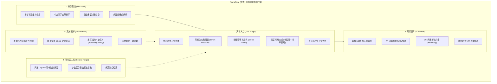
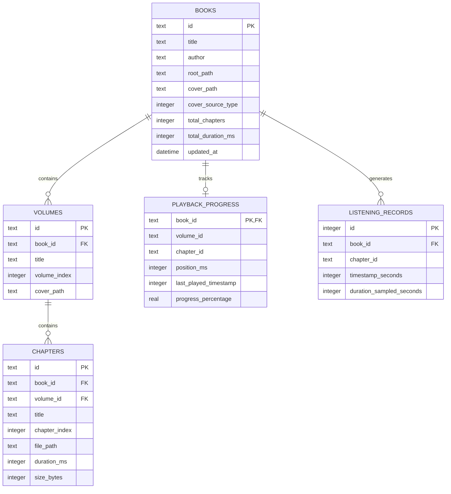

# TomeTone · 听卷 | 完整产品需求规格说明书 (PRD)

> **文档版本**：v2.0.0 (Clean Architecture & Local-First Edition)  
> **文档密级**：内部产品规格标准  
> **产品形态**：移动端为主、桌面端自适应为辅；100% 纯本地离线单机应用  
> **编写时间**：2026-10-17  

---

## 一、 产品愿景与定位 (Product Vision & Core Values)

### 1.1 产品使命 (Product Mission)
**TomeTone（听卷）** 是一款专为**重度有声阅读与长篇巨著收听者**打造的**高保真、沉浸式长篇有声书管理与声学播放平台**。
传统音乐播放器缺乏对“数百上千章节、多卷物理嵌套、长时间跨度收听遗忘”等有声书特殊痛点的针对性优化。TomeTone 聚焦于构建一个**纯本地单机（Local-First）、无隐私泄露风险、符合声学认知心理学**的长篇有声书离线数字藏馆与播放大台。

### 1.2 目标受众与典型画像 (User Personas)
1. **百万字长篇网文 / 大部头名著听书发烧友**：单部作品包含数卷、上千集音频，对章节排序准确性、换卷无缝切换有极致要求。
2. **通勤与睡前伴听重度用户**：常在地铁或睡前收听，要求“防打断漏听微回退”、“播完本章自然停播”、“拔耳机防社死外放保护”。
3. **个人离线有声库收藏家**：本地或移动存储中保存有 GB/TB 级别高保真有声书资源，排斥需要云端绑卡、可能下架的流媒体平台，追求纯粹本地掌控感。

### 1.3 核心设计原则 (Design Principles)
* **纯本地单机优先 (Local-First & Offline-Driven)**：所有书籍元数据、封面、断点、收听足迹与统计分析 100% 存储于本地 SQLite 数据库中，不依赖任何中心化云端服务器。
* **手机拇指工学优先 (Thumb-Centric Ergonomics)**：界面核心交互、播控大台、换章换卷控件全部下沉至手机屏幕下半区，单手即可完成高频盲操。
* **长篇声学心理学调优 (Acoustic Psychology)**：拒绝机械化硬切，引入阶梯式记忆唤醒微回退（Smart Resume）与双层（宏观全书/微观章节）联动时间轴。

---

## 二、 系统架构与功能全景图 (System Architecture & Feature Matrix)

---

## 三、 详细业务功能规格 (Functional Specifications)

### 3.1 模块一：书卷藏馆 (The Vault)

#### 3.1.1 物理拓扑自动推导与建库
* **需求描述**：用户指定本地包含有声书音频的文件目录（手机内部存储或 SD 卡），系统以静默/异步 Worker 深度递归遍历子树，推导出三级数据拓扑：`书籍 (Book) -> 分卷 (Volume) -> 章节 (Chapter)`。
* **推导规则**：
  * **单卷平铺模式**：书籍根目录下直接包含音频文件。系统自动构造默认单卷（如“全一卷”），音频文件映射为该卷内的有序章节。
  * **多卷嵌套模式**：书籍根目录下存在多个子文件夹且子文件夹内含音频。系统将根目录推导为“书”，各子目录推导为“卷”，子目录内音频推导为“章”。
  * **媒体格式兼容**：全量支持 `.mp3`, `.m4a`, `.m4b`, `.aac`, `.flac`, `.wav`, `.ogg`, `.opus`。非音频文件自动忽略。

#### 3.1.2 汉字数字与多位数自然排序 (Natural Sort Engine)
* **需求痛点**：传统操作系统采用 ASCII 字典序排序，导致例如“第10章”排在“第2章”前面，或者“第十章”排在“第一章”之后，严重破坏长篇小说的连贯剧情。
* **算法规则**：
  * **数值抽取**：自动切分文本块与数值块，数值块按整数真实大小比对（如 $10 > 2$）。
  * **中文序数映射**：算法识别并转换汉字数字（“一、二、三... 十、百、千”），将“第一卷”、“第十二章”、“卷三”、“第一百二十五章”动态映射为对应阿拉伯数值，严格保证文学创作序数完全顺延。

#### 3.1.3 四级多层封面继承机制 (Multi-tier Cover Decision)
* **需求描述**：长篇有声书可能存在整书封面、各卷专属插画，或完全无图的情况，系统提供自适应级联决断：
  1. **卷级专属优先**：若分卷目录下存在图片（`cover.jpg`, `folder.png` 等），该分卷优先展示专属封面。
  2. **全书封面继承**：若分卷无图，向上寻址书籍根目录下的全局封面图片，全卷统一继承。
  3. **首卷封面反哺**：若书籍根目录无图，但第一卷存在专属封面，系统自动提取第一卷封面反哺作为整本书的全局封面。
  4. **几何字标兜底**：若全书全卷均无任何图片，系统基于书名提取首汉字与首字母，配合国风主题色动态生成高质感字标矢量卡片，确保视觉统一不违和。

---

### 3.2 模块二：沉浸播放大台 (The Acoustic Stage)

#### 3.2.1 物理跨卷顺序连播与切歌规则
* **自动连播边界控制**：
  * 处于第 $V$ 卷第 $C$ 章末尾时，若当前卷仍有后续章节，无缝播放第 $V$ 卷第 $C+1$ 章；
  * 处于第 $V$ 卷最后一章末尾时，系统跨越分卷边界，自动加载第 $V+1$ 卷第 $1$ 章并继续播放；
  * 处于全书最后一卷最后一章末尾时，自动进入播放完毕态（Completed），优雅归零断点并重置播放状态。
* **上一曲（Previous）/ 下一曲（Next）工学判定**：
  * **下一曲**：按拓扑顺序切换到下一章节；若已到全书最后一章，操作无效且不影响当前播放。
  * **上一曲**：
    * 若当前章节**已播放时长 $> 3$ 秒**：视为用户希望重温本章开始，**重播当前章节**（进度跳回 0 秒）；
    * 若当前章节**已播放时长 $\le 3$ 秒**：跳回上一章；若当前是某卷第一章，自动跨卷切至上一卷最后一章；若已是第一卷第一章，则回到 0 秒重播。

#### 3.2.2 防剧情遗忘阶梯微回退 (Smart Resume Engine)
* **需求痛点**：听书极易被打断（接电话、地铁到站、开会）。恢复播放时若从原点开始，用户需要花费数秒甚至数十秒回忆上下文。
* **微回退计算公式**：
  $$\text{TargetPos} = \max\left(0, \text{SavedPos} - \text{Rewind}(\Delta T)\right)$$
  其中 $\Delta T$ 为本次暂停至恢复播放的中断间隔时长：

| 中断间隔时长（$\Delta T$） | 现实场景映射 | 微回退秒数（$\text{Rewind}$） |
| :--- | :--- | :--- |
| $\Delta T < 30 \text{ 秒}$ | 短暂查看即时消息 | **0 秒**（即点即播，不回退） |
| $30 \text{ 秒} \le \Delta T < 5 \text{ 分钟}$ | 接听电话、收发邮件 | **3 秒**（唤醒上一句听觉注意力） |
| $5 \text{ 分钟} \le \Delta T < 30 \text{ 分钟}$ | 短暂用餐、站台换乘 | **8 秒**（重温上一段情节） |
| $\Delta T \ge 30 \text{ 分钟}$ 或跨进程重启 | 深度中断、隔夜唤醒 | **15 秒**（快速找回故事大环境） |

#### 3.2.3 睡眠守夜状态机 (Sleep Timer)
* **双模式调度**：
  * **相对时长倒计时**：支持预设 15 分钟、30 分钟、45 分钟、60 分钟或自定义时长。剩余时间递减，时间归零时执行音量平滑渐弱并自动暂停。
  * **播完当前章节即停（End-of-Chapter Mode）**：不限剩余时长，系统拦截本章播毕时的自动切章行为，转为优雅暂停，为用户提供天然的入眠情节节点。
* **状态联动**：倒计时期间若用户手动点击停止或关闭播放器，定时器自动清空销毁。

#### 3.2.4 双层联动时间轴 (Dual-tier Progress Scrubber)
* **宏观时间轴（全书全局）**：展示全书整体进度百分比（基于全书所有音频总毫秒权重计算），显示全书总剩余收听时长。
* **微观时间轴（章节局部）**：高灵敏度滑动条，精确展示当前章节已播时长与总时长，拖动时支持毫秒级定位。

#### 3.2.5 5 键下沉式手机工学控制台
* 布局完全位于屏幕最下方的单手拇指黄金操作区：
  * **上一曲（Prev）**（重播或跨卷回退）
  * **快退 15 秒（Rewind 15s）**
  * **播放/暂停 主控制大按钮（Large Play/Pause FAB）**
  * **快进 30 秒（Forward 30s）**
  * **下一曲（Next）**（跨卷跳下一章）
* 支持倍速调控（$0.5\times \sim 3.0\times$ 动态平滑无失真变调变速）。

---

### 3.3 模块三：聆听纪年 (Chronicle & Metrics)

#### 3.3.1 30 秒心跳切片采样机制 (Heartbeat Sampling)
* **需求痛点**：如果仅通过“章节开始时间 - 章节结束时间”统计，用户挂机、后台卡死或快速拖动时间轴都会造成数据严重失真。
* **采样规则**：
  * 当播放器处于真实处于播放状态时，系统每隔 **30 秒** 触发一次物理切片心跳记录；
  * 心跳记录包含：书籍 ID、章节 ID、当前时间戳；
  * 暂停、缓冲或停止时不记录心跳，彻底排除挂机虚增。

#### 3.3.2 纪年统计看板
* **今日收听时长**：自动聚合今日 00:00 至今的所有有效心跳，实时计算分钟数。
* **累计总时长**：全库历史收听小时数。
* **365 天收听热力格 (Listening Heatmap)**：
  * 采用类似 GitHub Contribution 的 52 周 $\times$ 7 天网格设计；
  * 根据每日收听时长分级计算颜色深浅（无收听、1~30分钟、30~60分钟、60~120分钟、120分钟以上），直观展现收听习惯沉淀。
* **最近足迹时间流**：以倒序时间轴形式展示用户的最近收听书籍与章节，支持点击卡片“一键接续断点播放”。

---

### 3.4 模块四：听书源工坊 (Source Forge)

#### 3.4.1 开放 Legado 听书协议沙盒
* **源协议支持**：兼容 Legado（阅读）规范中的音频听书源（`bookSourceType: 1`），支持标准 JSON 源配置文件导入。
* **混合多语法提取引擎**：
  * 支持 JSONPath（RESTful 接口解析）；
  * 支持 CSS / DOM 选择器（HTML 网页解析）；
  * 支持复合正则表达式与模式替换（广告文本清洗）；
  * 自动处理相对 URL 路径向绝对 URL 的规范化拼装。
* **多源并发检索与发现**：支持全网书目关键字并发派发检索、分类榜单加载与在线目录树提取。

---

### 3.5 模块五：系统偏好与声学调控 (Preferences)

#### 3.5.1 雅致国风色盘与暗夜深邃模式
* **五套国风主题色盘**：
  1. **琥珀旧卷**（Warm Amber / 经典书卷暖棕）
  2. **竹海幽青**（Bamboo Green / 清润雅致翠绿）
  3. **星夜深蓝**（Deep Blue / 静谧夜读深蓝）
  4. **暮紫沉香**（Royal Purple / 沉稳典雅暮紫）
  5. **山丹丹红**（Vermilion / 浓郁朱砂丹红）
* **暗夜深邃模式（Dark Mode）**：深度针对 OLED 屏幕与暗光环境优化，界面底色切换为纯黑深灰，高对比度护眼配色。

#### 3.5.2 声学安全防护与外放防社死
* **拔耳机/蓝牙断开防外放保护 (Becoming Noisy)**：
  * 监听操作系统底层音频输出设备变更事件；
  * 一旦检测到有线耳机被拔出或蓝牙音频设备断开连接，系统于毫秒级内自动触发暂停，杜绝公共场合外放尴尬。
* **数据清理与重置**：提供一键清空收听纪年与足迹记录功能，保护个人收听隐私。

---

## 四、 界面与交互设计规范 (UI/UX Specifications)

### 4.1 响应式布局断点与端形态适配

| 屏幕形态 | 窗口宽度断点 | 主交互架构 | 导航方式 |
| :--- | :--- | :--- | :--- |
| **手机纵屏 (主形态)** | $W < 600\text{dp}$ | 单列通栏，下沉式布局，底部悬浮吸附 MiniPlayer | 底部 3 栏导航栏（书架、纪年、设置） |
| **桌面 / 平板 (辅助形态)** | $W \ge 600\text{dp}$ | 宽屏自适应，双列卡片网格，右侧常驻播放控制台 | 左侧侧边导航栏 (NavigationRail) |

### 4.2 底部吸附式 MiniPlayer 交互规范
* 当正在播放或有播放记录时，应用底部自适应浮现 MiniPlayer 播放底坞；
* **底坞元素**：微型封面图、书名与当前章节名跑马灯、简易播放/暂停按钮；
* **点击行为**：轻触 MiniPlayer 底坞，以平滑的 Material 3 向上容器展开动效（Container Transform）展开为全屏“播放大台（Mobile Player View）”。

---

## 五、 数据模型与持久化规范 (Data Schema Specifications)

系统采用 **Drift (Type-safe SQLite)** 构建离线关系型数据层，禁止使用脆弱的纯内存维护。

### 5.1 实体关系图 (Entity Relationship Diagram)

### 5.2 核心数据表设计规格
1. **`books` (书籍主表)**：记录本地有声书元数据、存储物理路径、封面路径及封面来源类型枚举。
2. **`volumes` (分卷表)**：保存分卷拓扑，关联 `book_id`，支持专属卷封面。
3. **`chapters` (章节表)**：保存具体章节物理文件路径、音频时长、文件大小与自然排序序号。
4. **`playback_progress` (播放进度断点表)**：以 `book_id` 为主键，记录该书最新播放到的卷、章、毫秒偏移量及最后收听时间戳。
5. **`listening_records` (收听纪年切片表)**：保存 30 秒心跳活跃记录，用于高效聚合今日收听与 365 天热力图。

---

## 六、 非功能性需求与系统质量要求 (Non-Functional Requirements)

### 6.1 性能与响应指标
* **大书库秒级扫描**：万级音频章节目录扫描与解析时间 $\le 3$ 秒，递归推导与自然排序必须在后台 Isolate 多线程执行，主 UI 保持 60/120 帧丝滑不掉帧。
* **启动冷时延**：应用冷启动至书架呈现时间 $\le 800\text{ms}$。
* **内存占用基线**：手机端常驻内存占用 $\le 120\text{MB}$，桌面端 $\le 80\text{MB}$。

### 6.2 后台保活与操作系统交互
* **Android 前台媒体服务 (Foreground Service)**：集成 `audio_service` 与 `MediaBrowserService`，声明 `FOREGROUND_SERVICE_MEDIA_PLAYBACK` 权限，防止切至后台或手机灭屏时被 Android LMK 强杀。
* **锁屏与控制中心**：通知栏与锁屏界面常驻 MediaNotification 卡片，显示当前封面大图、章节名、进度条并支持通知栏切歌。
* **耳机线控与蓝牙控制**：完美响应蓝牙耳机单按（播放/暂停）、双击（下一曲）、三击（上一曲）线控指令。

### 6.3 隐私与离线安全性
* **100% 纯本地运行**：严禁向任何第三方服务器上传用户的书籍列表、收听习惯、足迹数据或设备信息。
* **零账号体系**：完全不需要注册登录，开箱即用。

---

## 七、 验收标准与质量门禁 (Acceptance Criteria)

1. **功能闭环**：导入包含多层子文件夹的有声书目录后，能准确推导卷和章，并按中文数字完全排顺，封面正确展示。
2. **播放连贯**：上一章播完能自动切下一章；卷末能跨卷连播；全书播完能安全停播。
3. **微回退验证**：播放中暂停 10 分钟后恢复播放，进度精确自动后退 8 秒并平滑播放。
4. **睡眠守夜验证**：设定“播完当前章节即停”，到当前章节结束时准时停止播放，不再切章。
5. **纪年准确**：收听满 30 秒后，今日收听时长即刻累加，热力图对应格子着色。
6. **代码质量**：全库符合 Clean Architecture 分层架构，无任何全局未捕获异常，`flutter analyze` 保持 0 错误 0 警告交付。
